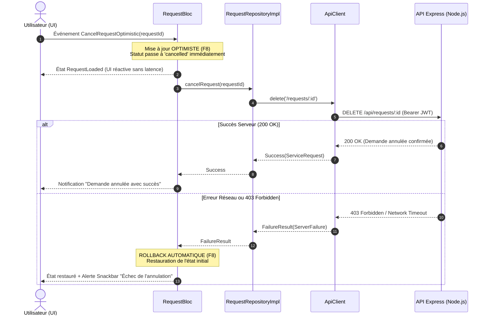

# CAHIER DES CHARGES & DOCUMENT DE CONCEPTION (DESIGN DOCUMENT)
## PROJET : FASOSKILLS (Topic T18 – HomeService : Local Artisans Marketplace)
**Cours :** Advanced Mobile Development – Year 3 (BIT)  
**Enseignant référent :** Dr Lebian Wilfried NIKIEMA  
**Stack technique :** Flutter + BLoC (Application Mobile) · Node.js + Express 5 + MongoDB (API REST & WebSockets)  
**Architecture :** Clean Architecture, Feature-First, Dependency Injection (`get_it`), Navigation Déclarative (`go_router`)  
**Version :** 1.0.0 — Conforme aux exigences du *Project Book*  

---

## SOMMAIRE
1. [Contexte, Problématique et Objectifs du Produit](#1-contexte-problématique-et-objectifs-du-produit)
2. [Acteurs, Rôles et Périmètre](#2-acteurs-rôles-et-périmètre)
3. [Exigences Fonctionnelles & User Stories (Priorisation MoSCoW)](#3-exigences-fonctionnelles--user-stories-priorisation-moscow)
4. [Modèle de Données & Décisions d'Ingénierie MongoDB](#4-modèle-de-données--décisions-dingénierie-mongodb)
5. [Spécification Complète de l'API REST & Contrat WebSocket](#5-spécification-complète-de-lapi-rest--contrat-websocket)
6. [Règles Métier & Sécurité Serveur (Défenses OWASP)](#6-règles-métier--sécurité-serveur-défenses-owasp)
7. [Architecture de l'Application Mobile Flutter](#7-architecture-de-lapplication-mobile-flutter)
8. [Parcours Utilisateur, Ergonomie & Gestion des États UI](#8-parcours-utilisateur-ergonomie--gestion-des-états-ui)
9. [Fonctionnalités Ajoutées & Comblement des Éléments Manquants](#9-fonctionnalités-ajoutées--comblement-des-éléments-manquants)
10. [Planification, Répartition des Rôles et Gestion des Risques](#10-planification-répartition-des-rôles-et-gestion-des-risques)

---

## 1. Contexte, Problématique et Objectifs du Produit

### 1.1 Contexte local
Au Burkina Faso (notamment à Ouagadougou, Bobo-Dioulasso et Koudougou), le secteur de l'artisanat et du dépannage à domicile (plomberie, électricité, menuiserie, maçonnerie, froid et climatisation) est très dynamique mais largement informel. 

### 1.2 Problématique
- **Côté Clients :** Difficulté à identifier rapidement un professionnel fiable et disponible en situation d'urgence (fuite d'eau, panne de disjoncteur). Le recours au bouche-à-oreille est lent, incertain et source d'asymétrie d'information sur les prix pratiqués.
- **Côté Artisans :** Manque de visibilité commerciale, dépendance au réseau géographique immédiat et absence d'un historique officiel attestant de leur sérieux (avis, badges de compétence).

### 1.3 Objectifs de la solution FasoSkills
1. Fournir une place de marché mobile instantanée mettant en relation directe les demandeurs de services et les artisans qualifiés.
2. Permettre la soumission et la comparaison transparente de devis (prix et délais d'intervention).
3. Intégrer un système de messagerie et de notification en temps réel via **WebSockets** pour fluidifier la négociation.
4. Garantir la sécurité des données, l'intégrité des transactions et la fiabilité grâce à un système d'avis vérifiés et de modération administrative.

---

## 2. Acteurs, Rôles et Périmètre

| Rôle | Description | Responsabilités & Droits |
| :--- | :--- | :--- |
| **Client (`client`)** | Particulier ou entreprise ayant un besoin de service ou dépannage. | - Consulter le catalogue des artisans et catégories.<br>- Publier, modifier et annuler ses demandes de devis.<br>- Consulter les offres reçues pour ses demandes.<br>- Accepter un devis unique.<br>- Échanger par messagerie instantanée.<br>- Laisser une évaluation (note + commentaire) après clôture. |
| **Artisan (`artisan`)** | Prestataire professionnel offrant ses compétences. | - Compléter et mettre à jour son profil professionnel (spécialité, ville, expérience, bio, disponibilité).<br>- Consulter le flux public des demandes de dépannage.<br>- Soumettre des devis chiffrés avec estimation de délai.<br>- Discuter en direct avec le client.<br>- Consulter l'historique de ses travaux et avis reçus. |
| **Administrateur (`admin`)** | Modérateur garant de la conformité et de la qualité. | - Gérer les catégories de métiers.<br>- Valider les pièces justificatives des artisans pour leur octroyer le badge **"Artisan Vérifié"**.<br>- Modérer les contenus abusifs ou frauduleux.<br>- Vue globale sur les métriques de la plateforme. |

---

## 3. Exigences Fonctionnelles & User Stories (Priorisation MoSCoW)

Le tableau suivant liste les **18 User Stories** couvrant l'ensemble du cycle de vie du produit :

| ID | En tant que... | Je veux... | Afin de... | Priorité |
| :---: | :--- | :--- | :--- | :---: |
| **US01** | Utilisateur (Client/Artisan) | créer un compte avec mon email, téléphone et mot de passe | accéder de manière sécurisée à la plateforme. | **MUST** |
| **US02** | Utilisateur | me connecter et recevoir une paire de jetons (access + refresh) | rester authentifié sans ressaisir mes identifiants. | **MUST** |
| **US03** | Utilisateur | me déconnecter sur l'application | révoquer ma session et sécuriser mon compte. | **MUST** |
| **US04** | Client | parcourir les artisans filtrés par métier et par ville | trouver rapidement le bon professionnel de proximité. | **MUST** |
| **US05** | Client | consulter les détails complets d'un profil artisan (bio, note, avis, badge) | évaluer sa crédibilité avant de le solliciter. | **MUST** |
| **US06** | Client | publier une demande de service avec titre, description, métier, ville et adresse | recevoir des devis personnalisés. | **MUST** |
| **US07** | Client | modifier ou annuler ma demande de service tant qu'elle est en attente | corriger une erreur ou annuler en cas de besoin. | **MUST** |
| **US08** | Artisan | consulter les demandes d'intervention ouvertes dans ma zone et mon métier | identifier des opportunités de chantiers. | **MUST** |
| **US09** | Artisan | soumettre une proposition de devis (montant en FCFA, délai en jours, message) | postuler pour réaliser les travaux. | **MUST** |
| **US10** | Client | voir la liste de tous les devis reçus uniquement pour mes propres demandes | comparer les offres reçues sans qu'un tiers ne les voie. | **MUST** |
| **US11** | Client | accepter un devis unique parmi les propositions reçues | engager officiellement l'artisan (la demande passe "en cours"). | **MUST** |
| **US12** | Client | noter (1 à 5 étoiles) et commenter la prestation une fois terminée | valoriser le travail de l'artisan et informer la communauté. | **MUST** |
| **US13** | Artisan | éditer mon profil professionnel (disponibilité, spécialité, expérience) | mettre en valeur mes compétences. | **MUST** |
| **US14** | Utilisateur | échanger des messages instantanés en direct via WebSockets | clarifier les aspects techniques ou logistiques sans rafraîchir. | **SHOULD** |
| **US15** | Client & Artisan | recevoir une alerte temps réel (WebSocket) lors de la réception ou validation d'un devis | réagir immédiatement sans délai d'attente. | **SHOULD** |
| **US16** | Utilisateur | consulter les artisans et catégories même en étant hors-ligne | utiliser l'application avec une connexion intermittente. | **SHOULD** |
| **US17** | Administrateur | attribuer le badge de vérification à un artisan après contrôle | instaurer un climat de confiance premium. | **SHOULD** |
| **US18** | Client / Artisan | téléverser des photographies de la panne ou du résultat des travaux | illustrer concrètement la nature du problème technique. | **COULD** |

---

## 4. Modèle de Données & Décisions d'Ingénierie MongoDB

### 4.1 Collections et Justification *Embed vs Reference* (Exigence Section 4 & 5.1)

| Collection | Type de relation | Choix d'ingénierie | Justification technique |
| :--- | :--- | :---: | :--- |
| `users` ➔ `artisan_profiles` | 1-to-1 | **Reference** (`userId`) | Tous les utilisateurs ne sont pas artisans. Séparer le compte utilisateur du profil professionnel évite de polluer le document d'authentification avec des données volumineuses (bio, avis, statistiques). |
| `service_requests` ➔ `users` | Many-to-1 | **Reference** (`clientId`) | Une demande appartient à un client. La référence permet de mettre à jour le profil client sans impacter les demandes archivées. |
| `quotes` ➔ `service_requests` | Many-to-1 | **Reference** (`requestId`) | Plusieurs artisans peuvent faire une offre sur un chantier. Ne pas imbriquer les devis dans la demande évite de dépasser la limite BSON de 16 Mo et permet d'appliquer une politique d'autorisation fine par devis. |
| `reviews` ➔ `artisan_profiles` | Many-to-1 | **Reference** (`artisanId`) | Le nombre d'avis grandit de manière non bornée (*unbounded array antipattern*). Les avis sont stockés séparément avec indexation sur `artisanId`. |
| `messages` ➔ `conversations` | Many-to-1 | **Reference** (`conversationId`) | Un chat actif génère des centaines de messages. Les imbriquer entraînerait des réallocations constantes de mémoire dans MongoDB. |

### 4.2 Schéma détaillé des collections

```
1. users
   ├── _id: ObjectId
   ├── email: String (unique, index)
   ├── phone: String (sparse, index)
   ├── fullName: String
   ├── passwordHash: String (Argon2 / bcrypt)
   ├── role: 'client' | 'artisan' | 'admin' (index)
   ├── isVerified: Boolean (default false)
   └── timestamps (createdAt, updatedAt)

2. refresh_tokens
   ├── _id: ObjectId
   ├── userId: ObjectId (ref User, index)
   ├── tokenHash: String (unique)
   ├── expiresAt: Date (index TTL 7 jours)
   └── isRevoked: Boolean (default false)

3. categories
   ├── _id: ObjectId
   ├── name: String (unique)
   ├── slug: String (unique, index)
   ├── icon: String
   ├── description: String
   └── isActive: Boolean (index)

4. artisan_profiles
   ├── _id: ObjectId
   ├── userId: ObjectId (ref User, unique, index)
   ├── category: ObjectId (ref Category, index)
   ├── specialty: String
   ├── city: String (index)
   ├── experienceYears: Number
   ├── bio: String
   ├── availability: String
   ├── rating: Number (0..5, index)
   ├── reviewsCount: Number
   ├── completedJobs: Number
   ├── isVerified: Boolean (index)
   └── profileStatus: 'incomplete' | 'complete'
   └── Indexes composés : { category: 1, city: 1 }, { specialty: 'text', bio: 'text' }

5. service_requests
   ├── _id: ObjectId
   ├── clientId: ObjectId (ref User, index)
   ├── categoryId: ObjectId (ref Category, index)
   ├── title: String
   ├── description: String
   ├── city: String (index)
   ├── address: String
   ├── photos: [String]
   ├── status: 'pending' | 'accepted' | 'in_progress' | 'completed' | 'cancelled' (index)
   ├── acceptedQuoteId: ObjectId (ref Quote)
   └── Indexes composés : { city: 1, status: 1 }, { createdAt: -1 }

6. quotes
   ├── _id: ObjectId
   ├── requestId: ObjectId (ref ServiceRequest, index)
   ├── artisanId: ObjectId (ref ArtisanProfile, index)
   ├── amount: Number (> 0)
   ├── estimatedDays: Number (>= 1)
   ├── message: String
   ├── status: 'pending' | 'accepted' | 'rejected' (index)
   └── Index d'unicité : { requestId: 1, artisanId: 1 } (1 seul devis par artisan par demande)

7. reviews
   ├── _id: ObjectId
   ├── requestId: ObjectId (ref ServiceRequest, unique, index)
   ├── clientId: ObjectId (ref User, index)
   ├── artisanId: ObjectId (ref ArtisanProfile, index)
   ├── rating: Number (1..5)
   ├── comment: String
   └── createdAt: Date (index { artisanId: 1, createdAt: -1 })

8. conversations & messages
   ├── conversations: _id, participants: [ObjectId], lastMessage: String, lastMessageAt: Date
   └── messages: _id, conversationId: ObjectId, senderId: ObjectId, text: String, isRead: Boolean, createdAt: Date
```

---

## 5. Spécification Complète de l'API REST & Contrat WebSocket

### 5.1 Format universel des réponses et des erreurs (Exigence A5)
- **Succès :**
  ```json
  {
    "data": { ... },
    "message": "Opération réussie"
  }
  ```
- **Succès Paginé (A9) :**
  ```json
  {
    "data": [ ... ],
    "pagination": {
      "page": 1,
      "limit": 10,
      "total": 45,
      "totalPages": 5,
      "hasNextPage": true,
      "hasPrevPage": false
    }
  }
  ```
- **Erreur centralisée (A5) :**
  ```json
  {
    "error": {
      "code": "VALIDATION_ERROR | UNAUTHORIZED | FORBIDDEN | NOT_FOUND | CONFLICT",
      "message": "Description compréhensible",
      "details": [ { "field": "amount", "message": "Le montant doit être positif" } ]
    }
  }
  ```

### 5.2 Table des Endpoints

| Verbe | Route | Rôle requis | Code 2xx | Codes Erreurs | Description & Règles de validation |
| :--- | :--- | :---: | :---: | :---: | :--- |
| `POST` | `/api/auth/register` | Public | 201 | 400, 409, 422 | Inscription avec validation Zod, hash du mot de passe |
| `POST` | `/api/auth/login` | Public | 200 | 401, 422 | Émission de l'access token (15m) et refresh token (7j) |
| `POST` | `/api/auth/refresh` | Public | 200 | 401 | Rotation stricte : l'ancien refresh token est immédiatement révoqué |
| `POST` | `/api/auth/logout` | Authentifié | 200 | 400 | Révocation en base du refresh token |
| `GET` | `/api/auth/me` | Authentifié | 200 | 401 | Récupération du profil utilisateur courant |
| `GET` | `/api/categories` | Public | 200 | - | Liste triée des corps de métier disponibles |
| `GET` | `/api/artisans` | Public | 200 | 400 | Liste paginée avec filtres `city`, `categoryId`, `search`, `minRating` |
| `GET` | `/api/artisans/:id` | Public | 200 | 404 | Détail complet d'un profil artisan |
| `PUT` | `/api/artisans/:id` | Artisan | 200 | 403, 404 | L'artisan ne peut éditer que son propre profil (**BOLA**) |
| `POST` | `/api/artisans/:id/verify` | Admin | 200 | 403, 404 | Validation et octroi du badge vérifié |
| `GET` | `/api/requests` | Public / Auth | 200 | 400 | Liste des demandes (avec option `myOnly=true`) |
| `POST` | `/api/requests` | Client | 201 | 401, 422 | Création de demande avec notification WebSocket globale |
| `PUT` | `/api/requests/:id` | Client | 200 | 403, 404 | Seul le client auteur peut modifier sa demande |
| `DELETE`| `/api/requests/:id` | Client | 200 | 403, 404 | Annulation de sa propre demande |
| `POST` | `/api/quotes` | Artisan | 201 | 403, 409, 422 | Un artisan certifié dépose un devis sur une demande `pending` |
| `GET` | `/api/quotes/request/:id` | Requester | 200 | 403, 404 | **Seul l'auteur de la demande** voit les devis concurrents |
| `POST` | `/api/quotes/:id/accept` | Client | 200 | 403, 404, 409 | Validation d'un devis unique : les autres passent `rejected` |
| `POST` | `/api/reviews` | Client | 201 | 403, 409, 422 | Évaluation autorisée **uniquement si la demande est `completed`** |
| `GET` | `/api/reviews/artisan/:id` | Public | 200 | 404 | Historique paginé des avis reçus par un artisan |
| `GET` | `/api/chat/conversations` | Authentifié | 200 | 401 | Liste des discussions actives de l'utilisateur |
| `GET` | `/api/chat/conversations/:id/messages` | Participant | 200 | 403, 404 | Historique des messages d'une discussion |
| `POST` | `/api/chat/conversations/:id/messages` | Participant | 201 | 403, 404 | Envoi d'un message avec diffusion WebSocket instantanée |

### 5.3 Contrat WebSocket (URL : `ws://localhost:8000/ws?token=<ACCESS_TOKEN>`)

```json
// 1. Événement envoyé par le serveur au client cible lors d'un nouveau devis
{
  "event": "quote:received",
  "data": {
    "requestId": "664fa...",
    "quote": { "id": "...", "amount": 15000, "estimatedDays": 1, "artisanName": "Moussa" }
  }
}

// 2. Événement envoyé à l'artisan lors de l'acceptation de son devis
{
  "event": "quote:accepted",
  "data": {
    "requestId": "664fa...",
    "quoteId": "664fb..."
  }
}

// 3. Événement de chat instantané dans le salon "conversation:<id>"
{
  "event": "message:received",
  "room": "conversation:664fc...",
  "data": {
    "id": "...",
    "senderId": "...",
    "text": "Bonjour, je serai sur place à 15h.",
    "createdAt": "2026-11-25T10:00:00Z"
  }
}
```

---

## 6. Règles Métier & Sécurité Serveur (Défenses OWASP)

1. **Aucun secret dans le dépôt (A3) :**
   - Toutes les variables critiques (`JWT_ACCESS_SECRET`, `JWT_REFRESH_SECRET`, `MONGODB_URI`) sont chargées via `.env` et validées au démarrage par un schéma strict Zod (`src/config/env.ts`). Le démarrage est avorté si une variable est manquante ou trop courte.
2. **Rotation des jetons et révocation de session (A6) :**
   - L'access token a une durée de vie courte de 15 minutes.
   - Les refresh tokens sont stockés sous forme de hash cryptographique SHA-256 en base de données.
   - À chaque rafraîchissement, le jeton utilisé est révoqué et un nouveau jeton est généré (détection de vol de session).
3. **Contrôle d'accès au niveau objet (BOLA / A7 / A12) :**
   - L'API vérifie systématiquement que `request.clientId === req.user.id`. Le client B reçoit une erreur `403 FORBIDDEN` s'il tente d'altérer la demande du client A.
   - Seul le client ayant émis la demande peut consulter l'ensemble des devis soumis pour celle-ci. Un artisan ne peut visualiser que son propre devis.
4. **Règle d'acceptation unique de devis (T18) :**
   - Lorsqu'un devis est accepté, son statut passe à `accepted`, tous les autres devis concurrents sont automatiquement marqués `rejected`, et le statut de la demande bascule sur `in_progress`.
5. **Intégrité des avis clients (T18) :**
   - Un avis ne peut être posté que par le client ayant créé la demande, et uniquement si le statut est `completed`.
   - La note globale de l'artisan et son nombre de chantiers terminés sont recalculés et mis à jour de manière cohérente en base.
6. **Sécurité périmétrique (A11) :**
   - `helmet` pour la protection des en-têtes HTTP.
   - `express-rate-limit` plafonnant les tentatives sur `/api/auth` (100 requêtes / 15 minutes) pour contrer le brute-force.
   - Limitation de la taille du payload JSON à 5 Mo.

---

## 7. Architecture de l'Application Mobile Flutter

### 7.1 Découpage Clean Architecture Feature-First (Exigence F1, F3)

```
app/lib/
├── core/
│   ├── config/             # AppConfig (API_BASE_URL via --dart-define - F13)
│   ├── errors/             # Failure, ServerFailure, Result<T> (F3)
│   ├── network/            # ApiClient (concurrency-safe refresh - F6), WebSocketClient
│   ├── storage/            # SecureStorageService (F6), CacheService (F9)
│   ├── di/                 # injection.dart (GetIt composition root - F4)
│   ├── router/             # app_router.dart (GoRouter avec route guard d'auth - F5)
│   └── theme/              # AppTheme (charte graphique indigo / orange)
├── features/
│   ├── auth/
│   │   ├── domain/         # Modèles purs (User), Contrat (AuthRepository)
│   │   ├── data/           # AuthRepositoryImpl, stockage sécurisé
│   │   └── presentation/   # AuthBloc, LoginScreen, RegisterScreen, SplashScreen
│   ├── artisans/
│   │   ├── domain/         # Modèles (Artisan, Category), Contrat (ArtisanRepository)
│   │   ├── data/           # ArtisanRepositoryImpl avec gestion du cache hors-ligne
│   │   └── presentation/   # ArtisanListBloc, HomeScreen, SearchScreen
│   ├── requests/
│   │   ├── domain/         # Modèles (ServiceRequest, Quote), Contrat (RequestRepository)
│   │   ├── data/           # RequestRepositoryImpl
│   │   └── presentation/   # RequestBloc (optimistic update & rollback), MyRequestsScreen
│   └── chat/
│       ├── domain/         # Modèle (ChatMessage), Contrat (ChatRepository)
│       ├── data/           # ChatRepositoryImpl
│       └── presentation/   # ChatBloc (synchronisé WebSockets), MessagesScreen
└── main.dart               # Initialisation GetIt, WebSocket et runApp
```

### 7.2 Diagramme d'interaction d'une fonctionnalité (Exigence Section 5.1)



---

## 8. Parcours Utilisateur, Ergonomie & Gestion des États UI

### 8.1 Les 4 États UI obligatoires sur chaque écran (Exigence F7)
Chaque vue consommatrice de données implémente un rendu explicite pour :
1. **État Chargement (`Loading`) :** Indicateur circulaire centré aux couleurs de l'application ou skeleton screens.
2. **État Vide (`Empty`) :** Illustration vectorielle avec message d'accompagnement contextuel (ex: *"Aucun artisan trouvé dans cette zone"*).
3. **État Erreur avec Réessai (`Error with Retry`) :** Boîtier stylisé rouge affichant le message d'erreur et un bouton d'action *"Réessayer"* rechargeant le BLoC.
4. **État Données (`Loaded`) :** Contenu dynamique avec prise en charge du *Pull-to-refresh*.

### 8.2 Fonctionnalités d'ergonomie avancée
- **Cache-then-network (F9) :** Au démarrage sans connexion internet, l'écran d'accueil charge immédiatement la liste des artisans sauvegardée dans le cache local avec un badge discret *"Données hors-ligne"*, puis rafraîchit les données dès que le réseau redevient disponible.
- **Event Transformer Debounce (F8) :** La barre de recherche applique une temporisation de **300 ms** via `stream_transform` pour éviter d'envoyer une requête à chaque frappe de touche.
- **Rafraîchissement sécurisé des tokens (F6) :** L'intercepteur HTTP gère la concurrence : si trois requêtes simultanées reçoivent un code 401, une seule demande de renouvellement (`/auth/refresh`) est émise ; les deux autres attendent le résultat avant d'être rejouées automatiquement.

---

## 9. Fonctionnalités Ajoutées & Comblement des Éléments Manquants

Par rapport au code initial du projet qui présentait des lacunes critiques, les ajouts suivants ont été conçus et intégrés :

1. **Intégration Temps Réel WebSockets (Demande explicite) :**
   - Mise en place d'un protocole WebSocket complet avec reconnexion automatique et authentification par jeton.
   - Synchronisation instantanée des devis et des messages de chat sans polling HTTP.
2. **Gestion des Rôles & Backoffice d'Administration :**
   - Ajout d'une route dédiée pour la validation administrative des artisans (`POST /api/artisans/:id/verify`).
   - Gestion du statut de profil (`incomplete` vs `complete`).
3. **Conformité stricte aux exigences de soutenance :**
   - Remplacement de l'architecture Django/SQLite par Node.js/TypeScript/Mongoose.
   - Remplacement de `provider` par `flutter_bloc`.
   - Couverture par tests automatisés : 20 tests d'intégration API + 7 tests unitaires BLoC.
   - Script de peuplement automatisé de données de démonstration (`npm run seed`).
4. **Intégration d'un Pipeline CI/CD :**
   - Fichier `.github/workflows/ci.yml` assurant la validation automatique du formatage, de la compilation statique TypeScript et de l'ensemble des tests lors de chaque pull request.

---

## 10. Planification, Répartition des Rôles et Gestion des Risques

### 10.1 Calendrier des Jalons (*Milestones*)

| Jalon | Date cible | Livrables attendus | Statut |
| :--- | :---: | :--- | :---: |
| **M0 : Équipe et Sujet** | Semaine 1 | Enregistrement du sujet T18, création du monorepo Git, invitation de l'enseignant. | **Validé** |
| **M1 : Conception (Design)** | Fin Sem. 2 | Cahier des charges (ce document), user stories, modèles de données, diagrammes d'architecture. | **Validé** |
| **M2 : Walking Skeleton** | Fin Sem. 4 | Authentification de bout en bout (register/login/refresh/logout), liste des artisans, pipeline CI actif. | **Validé** |
| **M3 : Feature Complete** | Fin Sem. 6 | Toutes les règles métier T18 (devis unique, avis post-chantier), tests d'intégration et tests BLoC au vert. | **Validé** |
| **M4 : Release Candidate** | Fin Sem. 7 | Fonctionnalité avancée WebSockets, builds release APK, rapport final d'ingénierie, freeze du code. | **Validé** |
| **Défense / Soutenance** | Semaine 8 | Démonstration en direct sur téléphone réel, présentation orale de 25 minutes et questions du jury. | **Prêt** |

### 10.2 Matrice des Risques Techniques et Mesures de Contingence

| Risque identifié | Probabilité | Impact | Stratégie d'atténuation mise en place |
| :--- | :---: | :---: | :--- |
| **Instabilité réseau mobile locale (3G/4G intermittente)** | Élevée | Élevé | Implémentation du pattern *Cache-then-network* (F9) pour un affichage immédiat hors-ligne et retry automatique. |
| **Déconnexion brutale des WebSockets** | Moyenne | Moyen | Mécanisme de reconnexion automatique côté Flutter avec fallback sur requêtes REST au rechargement de page. |
| **Collision lors de la validation simultanée de deux devis** | Faible | Élevé | Règle d'atomicité sur le serveur MongoDB : le premier devis accepté verrouille la demande et rejette immédiatement les concurrents. |
| **Pénalité pour secret commité (-5 pts)** | Faible | Élevé | Validation Zod au démarrage, exclusion stricte via `.gitignore` et fichier `.env.example` sans clé sensible. |
